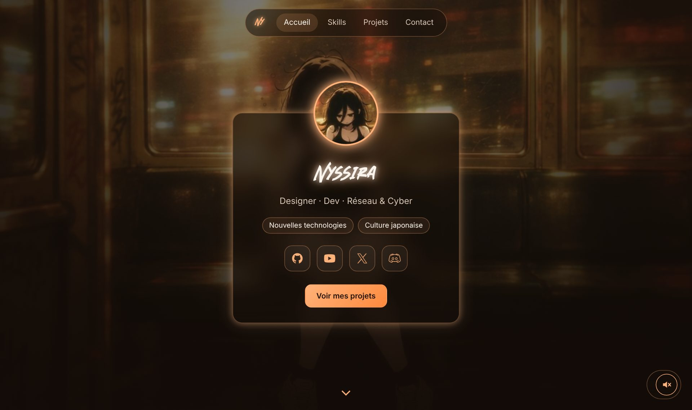

<div align="center">

# Nyssira

**Designer · Dev · Réseau & Cyber**

[](https://lappl4nd.github.io)
[](https://discord.gg/DhWAsP8nQx)
[](https://www.youtube.com/@Ahegao_)

<br>



</div>

---

## À propos

Mon site perso, hébergé avec **GitHub Pages**. On y trouve mon profil, mes compétences, mes projets et le moyen de me contacter, le tout sur une seule page avec un fond vidéo et une musique d'ambiance.

## Fonctionnalités

- **Une seule page** avec menu de navigation (Accueil, Skills, Projets, Contact)
- **Responsive** : s'adapte au PC, à la tablette et au téléphone
- **Fond vidéo** avec image d'attente pendant le chargement
- **Musique d'ambiance** à lancer avec le bouton en bas à droite, volume mémorisé
- **Barres de compétences animées** qui se remplissent au scroll
- **Effet verre** (glassmorphism) et lueurs néon orange
- **Zéro dépendance** : HTML, CSS et JavaScript, rien à installer

## Structure

```
LapPl4ND.github.io/
├── index.html        Page du site
├── css/
│   └── main.css      Styles (couleurs, mise en page, animations)
├── js/
│   └── main.js       Musique, animations au scroll, menu actif
├── img/              Avatar, icônes, fond vidéo et image d'attente
├── font/             Police des titres (Blank River)
└── song/             Musique d'ambiance
```

## Personnaliser

| Je veux… | Où | Comment |
|---|---|---|
| Changer un skill | `index.html` | Modifier le nom et la valeur `--lvl` (ex. `style="--lvl:80"`) |
| Ajouter un projet | `index.html` | Copier un bloc `<article class="card project">` |
| Changer les couleurs | `css/main.css` | Modifier `--accent`, `--accent-strong` et `--accent-soft` en haut du fichier |
| Changer le fond | `img/` | Remplacer `bg.mp4` et `bg-poster.jpg` |
| Changer la musique | `song/` | Remplacer `MusicF2.mp3` |

> Après une modif du CSS ou du JS, augmenter le numéro `?v=` dans `index.html` (ex. `?v=5` → `?v=6`) pour que les visiteurs voient la nouvelle version directement.

## Lancer en local

Aucune installation : ouvrir `index.html` dans un navigateur.

## Mettre en ligne

1. Modifier les fichiers dans ce dossier
2. Dans GitHub Desktop : **Commit to main** puis **Push origin**
3. Le site se met à jour sur [lappl4nd.github.io](https://lappl4nd.github.io) en 1 à 2 minutes

## Crédits

- Police des titres : *Blank River*
- Illustrations, fond animé et musique : propriété de leurs auteurs respectifs

---

<div align="center">
<sub>Fait par Nyssira</sub>
</div>
